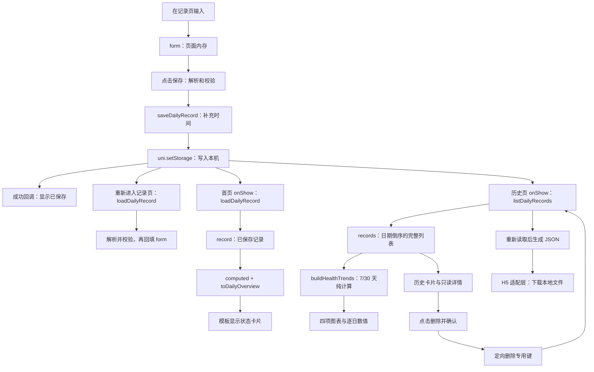
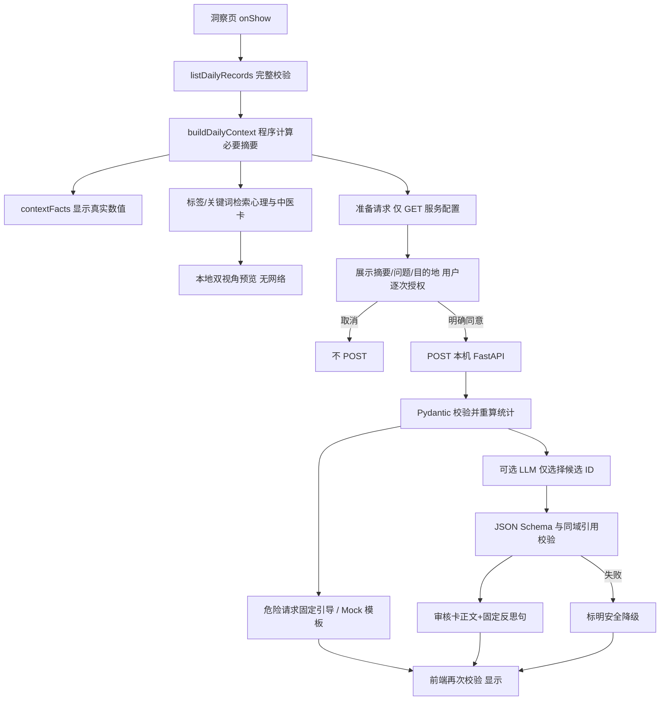

# MindBody：一条记录怎样保存和显示

更新日期：2026-11-19。对应 V0.6：第 1–8 节说明保留的每日/历史/管理/趋势，第 9 节说明新增洞察。存储格式仍与 V0.2 兼容。

把记录路径想成“填写一张表，把它放进本机按日期命名的抽屉，首页再打开今天的抽屉”。记录保存不经过后端；洞察有另行授权的本机服务路径，没有数据库。



## 1. 输入先放在页面内存

`src/pages/record/index.vue` 使用 `reactive` 创建 `form`。输入框通过 `v-model` 与字段连接：你输入睡眠 `7.5`，`form.sleepHours` 就变成字符串 `'7.5'`。

这时**还没有保存**。`form` 只在页面运行时存在，刷新或离开页面可能丢失未保存输入。睡眠先用字符串，是为了分清 `''`（没填）和 `'0'`（填了 0 小时）；三个量表没选时是 `undefined`。

## 2. 点击保存，先转换并检查

`saveRecord()` 调用 `src/utils/record-validation.ts` 中的 `parseRecordForm(form, date)`：

- 将非空睡眠文字转换成数字；检查 0–24 小时。
- 检查量表为 1–5 的整数，文本不超过 500 字符，并去除首尾空白。
- 至少填写一项；没有填写的字段不进入记录，不自动补 0 或 3。
- 校验不通过时只显示错误，不调用存储写入。

例如以下是虚构的教学输入：

```ts
// 表单：输入框保存文字，精力和压力没选。
{ sleepHours: '7.5', bodyNote: '', mood: 4 }

// 校验后的记录内容：睡眠变成数字，未填写项不出现。
{ date: '2026-11-19', mood: 4, sleepHours: 7.5 }
```

`src/types/health.ts` 中的类型是“约定的数据形状”，帮助编辑器提前发现错误。类型不会替我们检查浏览器里实际读出的数据，所以仍需要运行时校验。

## 3. 存储模块统一写入

页面把校验结果交给 `src/storage/daily-records.ts` 的 `saveDailyRecord()`。它会再次校验，并先读取当天旧记录：

1. 第一次保存：生成 `createdAt` 和 `updatedAt`。
2. 再次保存：保留原 `createdAt`，更新 `updatedAt`，用本次表单内容替换当天记录。清空的可选项目也会移除，不能把整条记录保存为空。
3. 若旧数据读取失败或格式异常，停止保存，避免误覆盖。
4. 把 `{ version: 1, record }` 转成 JSON 字符串，交给 `uni.setStorage`。
5. 等待写入成功回调，才向页面返回记录、显示“已保存”；失败时显示错误并保留当前输入。

“JSON”是把对象写成文本的格式。存储键相当于抽屉标签，例如：

```text
mindbody:daily-record:v1:2026-11-19
```

`v1` 是保存格式的版本，便于将来升级时辨认。每个日期有一个键，今天再次保存更新今天，不改其他日期。`date` 使用设备本地日期；两个时间戳使用 ISO 时间字符串，含 `Z` 表示 UTC 时间。

当前 Web 运行时，`uni.*Storage` 使用浏览器的 `localStorage`。刷新只会重建页面内存，不会主动清除这份本地存储；记录没有写进源码、`mock.ts` 或 Git。

## 4. 三个页面读取同一份记录

`loadDailyRecord(date)` 先检查当天的键是否存在，再用 `uni.getStorage` 取出、解析 JSON、核对版本和字段。

| 结果 | 含义 | 页面怎么处理 |
| --- | --- | --- |
| `null` | 这个日期没有记录 | 首页提示尚未记录；表单保持空白 |
| `DailyRecord` 对象 | 记录读取并校验成功 | 首页显示概览；表单回填已保存内容 |
| 抛出错误 | 读取失败或格式异常 | 显示错误与重试，不假装没有记录，不改原数据 |

记录页在 `onShow`（页面每次显示时）读取并回填。数字睡眠会重新转成输入框需要的文字，0 会转成 `'0'`，缺失会转成 `''`。这也确保在历史页删除后，再返回已存在的记录页时不会沿用旧数据；未保存草稿不跨页面保留。

首页在 `onShow`（页面每次出现时）读取，包括第一次进入、刷新、从记录页返回。使用它的原因是：页面可能仍保留在内存中，但你在别处刚保存了新内容，它需要重新读取。多个读取请求先后返回时，只接收最后发起的一次，避免旧结果盖住新结果。

## 5. 首页把记录转换成界面

首页把读取结果放进 `record` 这个 `ref`。`computed` 会随 `record.value` 的改变，自动调用 `src/utils/daily-overview.ts` 的 `toDailyOverview()`：

- `mood: 4` → “较愉快”，并显示 `4 / 5 · 越高越愉快`。
- `sleepHours: 7.5` → “7.5 h”；`sleepHours: 0` → “0 h”。
- 没有 `energy` → “未填写”，不会解释为精力正常。

首页和表单的量表文字都来自 `src/data/scales.ts`，同一个分数具有同一个含义。模板用 `v-for` 画出四张卡片，Vue 自动刷新文字，无需手动修改网页元素。

概览只是从记录算出来的展示内容，**不再存一份首页数据**，因此两个页面不会各有一套互不一致的保存结果。

## 6. 怎样理解数据会不会丢

- 填了但没成功保存：只在页面内存，刷新可能丢失。
- 已成功保存：同一浏览器、同一地址和日期下，刷新可以重新读取。
- `http://127.0.0.1:5173` 与 `http://localhost:5173`、端口 5174、另一浏览器的存储不同，不能互相读取。
- 新的一天首页只查新日期；昨天的记录仍留在本地，可通过历史列表查看。
- 本地存储未加密，清理网站数据、无痕窗口结束或更换设备可能无法找回；目前没有云同步。
- 两个标签页同时修改同一天时，以最后成功保存为准；本轮未实现实时跨标签页更新或冲突合并，首页再次显示或刷新时重新读取。

最值得掌握的三个概念是：**页面内存与持久化的区别**、**类型约定与实际校验的区别**、**数据改变如何通过响应式机制更新界面**。

## 7. 历史、趋势和导出如何复用数据

`listDailyRecords()` 先获取存储键，筛选当前 v1 专用前缀，只读取这些键的值；解析并校验全部记录，再按日期倒序返回。历史页 `records` 是读取结果的内存副本，不会另存“历史缓存”。任何一条读取失败或损坏都报错，不能把剩余记录当作完整列表。

历史卡片和首页共用 `toDailyOverview()`，所以缺项文字与量表含义一致。详情展示原来的创建/更新时间，不在读取时重新生成。

趋势调用 `buildHealthTrends(records, 7或30, 今天)`，这个纯函数只接收数据并返回结果，不访问存储，也不修改输入：

```ts
// 虚构例子：两天填了睡眠，一天空缺。
[{ date: '2026-11-17', value: 0 },
 { date: '2026-11-18', value: null },
 { date: '2026-11-19', value: 8 }]
// 已填 2 天，平均 (0 + 8) / 2 = 4；不能除以 3，也不能把 null 画成 0。
```

每项分别有填写天数与平均值。图表只是展示这些结果；窗口外数据、未填指标不进入该项统计。0 个样本无平均值，1 个样本提示不足。趋势不再存储，源记录删除后重新计算即可。

导出按钮会再次调用 `listDailyRecords()`，避免页面旧数组遗漏新记录。`serializeRecordExport()` 校验并生成 `{schemaVersion:1, exportedAt, records}`。`platform/export-json.ts` 在 H5 使用 Blob 触发 JSON 下载，不发送到服务器；下载失败给出提示。JSON 中缺失的可选字段仍不出现，0 与时间戳保留。当前没有导入恢复功能。

## 8. 删除为什么要确认、预检和重读

页面负责用户意愿：单条显示日期并确认；清空先确认范围，再确认不可恢复，两个确认框都默认取消。取消只关闭框，不调用存储接口。

存储模块负责实际操作：`deleteDailyRecord(date)` 校验目标记录后调用 `uni.removeStorage`，再检查专用键确实消失。`deleteAllDailyRecords()` 先完整校验列表，再逐条删除，只操作当前 v1 专用键，绝不调用 `clearStorage`。

多个键的删除没有数据库事务支持。如果第 3 条失败，前两条可能已删除，所以不能简单提示“全部失败、什么都没变”。模块报告已确认删除数量，页面无论成功失败都重新读取实际列表，趋势随 `computed` 重算。首页和记录页再次出现时也会重新读取。

这就是**单一数据来源**：真正的数据只有存储中的记录；首页、历史、图表都是读取后的不同展示。确认框表达意愿，Promise/await 等待操作结果，重读验证真实状态。V0.6 洞察复用同一接口；AI 周报仍未实现。

## 9. 洞察如何使用记录与 AI



类型层 `types/insight.ts` 像表格的列定义，规定 DailyContext、KnowledgeCard、DailyInsight 等的形状。`daily-context.ts` 是计算器：输入经存储层验证的记录，输出 7 日数值与填写数/平均值/首末差；不读网络、不改记录。未填指标在摘要中明确写 null，0 保留为数值。只有一条记录时没有差值，不编造长期趋势。

摘要不包含身体备注、创建/更新时间、用户标识。比如虚构记录 `{mood:4,sleepHours:0,bodyNote:'示例'}`，摘要 today 只有 `{mood:4,stress:null,energy:null,sleepHours:0}`。备注仍只在原存储里；问题框中输入的文字会随当次授权请求发送，因此需要用户查看完整预览。

`utils/insight.ts` 从两个独立 JSON 知识域检索卡片，先生成无需服务的教育预览。来源、证据类型与局限跟着卡片显示。“来源核对”不是临床有效性保证，传统中医理论不作为现代医学结论，也不由情绪分数推出证候。

`services/insight-api.ts` 像接线员：准备按钮只读取不含健康数据的服务配置；真正的 POST 需要当次授权快照。快照保留的摘要、问题和模式与用户预览一致。Mock 发给本机 8000，不调用外部模型；真实模式再发给已显示的服务商。离开页面会撤销未发送的授权，已经发送的网络数据无法撤回，但迟到结果不会覆盖新页面。

服务端 `models.py` 再核对日期、today 和统计，防止错误摘要继续传播；`engine.py` 检索相同 JSON 卡片。真实模型只返回“哪个卡片 ID、哪个反思句 ID”，由程序装配正文。ID 不存在、串域、附带任意医疗建议或 API 失败都会拒绝采用并标记降级。模型是受限制的选择器，不是计算器或诊疗系统。

返回后前端再核对 ID 与正文。所有数值仍显示前端程序事实，模型不能生成新分数。对话最多保留最近 12 条页面消息，只发送当前问题，不把过去聊天再上传；刷新/重新进入清除。微行动也是页面 ref 中的单个 ID，选另一项即替换，既不调用存储也不发送 API。

因此，**记录持久化、派生计算、网络授权、页面内存是四件不同的事**：保存记录只改本机抽屉；打开洞察只读和计算；同意后才传输摘要；聊天与微行动不会自动变成长期健康记录。
