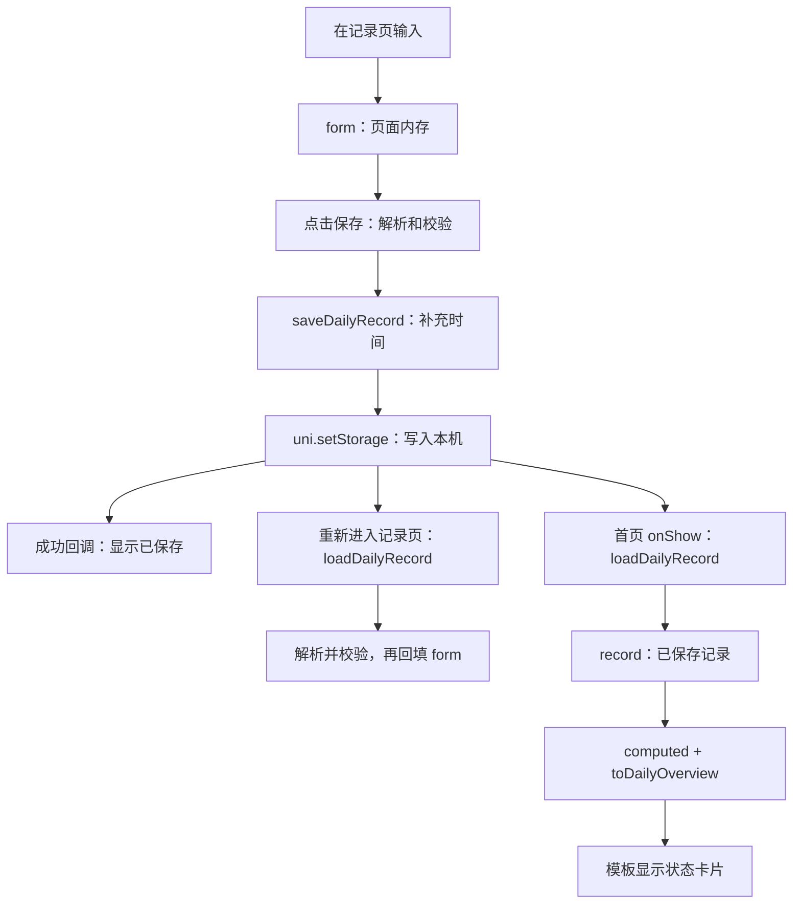

# MindBody：一条记录怎样保存和显示

更新日期：2026-11-19。对应 V0.2 每日记录与首页联动。

把这条路径想成“填写一张表，把它放进本机按日期命名的抽屉，首页再打开今天的抽屉”。目前没有后端、数据库或大模型调用。



## 1. 输入先放在页面内存

`src/pages/record/index.vue` 使用 `reactive` 创建 `form`。输入框通过 `v-model` 与字段连接：你输入睡眠 `7.5`，`form.sleepHours` 就变成字符串 `'7.5'`。

这时**还没有保存**。`form` 只在页面运行时存在，刷新或离开页面可能丢失未保存输入。睡眠先用字符串，是为了分清 `''`（没填）和 `'0'`（填了 0 小时）；三个量表没选时是 `undefined`。

## 2. 点击保存，先转换并检查

`saveRecord()` 调用 `src/utils/record-validation.ts` 中的 `parseRecordForm(form, date)`：

- 将非空睡眠文字转换成数字；检查 0–24 小时。
- 检查量表为 1–5 的整数，文本不超过 500 字符，并去除首尾空白。
- 至少填写一项；没有填写的字段不进入记录，不自动补 0 或 3。
- 校验不通过时只显示错误，不调用存储写入。

例如以下是虚构的教学输入：

```ts
// 表单：输入框保存文字，精力和压力没选。
{ sleepHours: '7.5', bodyNote: '', mood: 4 }

// 校验后的记录内容：睡眠变成数字，未填写项不出现。
{ date: '2026-11-19', mood: 4, sleepHours: 7.5 }
```

`src/types/health.ts` 中的类型是“约定的数据形状”，帮助编辑器提前发现错误。类型不会替我们检查浏览器里实际读出的数据，所以仍需要运行时校验。

## 3. 存储模块统一写入

页面把校验结果交给 `src/storage/daily-records.ts` 的 `saveDailyRecord()`。它会再次校验，并先读取当天旧记录：

1. 第一次保存：生成 `createdAt` 和 `updatedAt`。
2. 再次保存：保留原 `createdAt`，更新 `updatedAt`，用本次表单内容替换当天记录。清空的可选项目也会移除，不能把整条记录保存为空。
3. 若旧数据读取失败或格式异常，停止保存，避免误覆盖。
4. 把 `{ version: 1, record }` 转成 JSON 字符串，交给 `uni.setStorage`。
5. 等待写入成功回调，才向页面返回记录、显示“已保存”；失败时显示错误并保留当前输入。

“JSON”是把对象写成文本的格式。存储键相当于抽屉标签，例如：

```text
mindbody:daily-record:v1:2026-11-19
```

`v1` 是保存格式的版本，便于将来升级时辨认。每个日期有一个键，今天再次保存更新今天，不改其他日期。`date` 使用设备本地日期；两个时间戳使用 ISO 时间字符串，含 `Z` 表示 UTC 时间。

当前 Web 运行时，`uni.*Storage` 使用浏览器的 `localStorage`。刷新只会重建页面内存，不会主动清除这份本地存储；记录没有写进源码、`mock.ts` 或 Git。

## 4. 两个页面读取同一份记录

`loadDailyRecord(date)` 先检查当天的键是否存在，再用 `uni.getStorage` 取出、解析 JSON、核对版本和字段。

| 结果 | 含义 | 页面怎么处理 |
| --- | --- | --- |
| `null` | 这个日期没有记录 | 首页提示尚未记录；表单保持空白 |
| `DailyRecord` 对象 | 记录读取并校验成功 | 首页显示概览；表单回填已保存内容 |
| 抛出错误 | 读取失败或格式异常 | 显示错误与重试，不假装没有记录，不改原数据 |

记录页在 `onLoad`（页面创建时）读取并回填。数字睡眠会重新转成输入框需要的文字，0 会转成 `'0'`，缺失会转成 `''`。

首页在 `onShow`（页面每次出现时）读取，包括第一次进入、刷新、从记录页返回。使用它的原因是：页面可能仍保留在内存中，但你在别处刚保存了新内容，它需要重新读取。多个读取请求先后返回时，只接收最后发起的一次，避免旧结果盖住新结果。

## 5. 首页把记录转换成界面

首页把读取结果放进 `record` 这个 `ref`。`computed` 会随 `record.value` 的改变，自动调用 `src/utils/daily-overview.ts` 的 `toDailyOverview()`：

- `mood: 4` → “较愉快”，并显示 `4 / 5 · 越高越愉快`。
- `sleepHours: 7.5` → “7.5 h”；`sleepHours: 0` → “0 h”。
- 没有 `energy` → “未填写”，不会解释为精力正常。

首页和表单的量表文字都来自 `src/data/scales.ts`，同一个分数具有同一个含义。模板用 `v-for` 画出四张卡片，Vue 自动刷新文字，无需手动修改网页元素。

概览只是从记录算出来的展示内容，**不再存一份首页数据**，因此两个页面不会各有一套互不一致的保存结果。

## 6. 怎样理解数据会不会丢

- 填了但没成功保存：只在页面内存，刷新可能丢失。
- 已成功保存：同一浏览器、同一地址和日期下，刷新可以重新读取。
- `http://127.0.0.1:5173` 与 `http://localhost:5173`、端口 5174、另一浏览器的存储不同，不能互相读取。
- 新的一天首页只查新日期；昨天的记录仍留在本地，但当前还没有历史列表入口。
- 本地存储未加密，清理网站数据、无痕窗口结束或更换设备可能无法找回；目前没有云同步。
- 两个标签页同时修改同一天时，以最后成功保存为准；本轮未实现实时跨标签页更新或冲突合并，首页再次显示或刷新时重新读取。

最值得掌握的三个概念是：**页面内存与持久化的区别**、**类型约定与实际校验的区别**、**数据改变如何通过响应式机制更新界面**。
