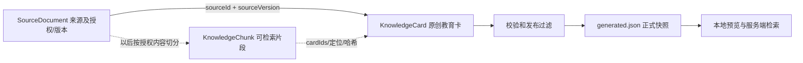

# MindBody 知识库：先理解三个层次

对应 V0.7（2026-11-25）。这是知识工程基础，不是临床知识库认证。原 4 张卡继续使用，未新增外部全文、向量数据库或 Agent。

## 数据库、知识库、RAG 有什么区别

| 概念 | 解决什么问题 | MindBody 当前例子 |
| --- | --- | --- |
| 数据库 | 怎样保存、查询数据 | 每日记录目前用 uni 本地存储，尚无服务端数据库 |
| 知识库 | 哪些内容可信、来自哪里、能否使用、何时更新/撤回 | 来源目录 + 审核知识卡 + 发布规则，存成 JSON 也可以是知识库 |
| RAG | 回答前先检索相关材料，再把候选材料交给模型 | 当前只有标签/关键词检索与受控卡片选择，未做语义向量检索 |

数据库是一种保存工具；知识库还需要内容、来源、审核、授权和版本；RAG 是使用知识的一种流程。把很多 PDF 丢进向量库，并不会自动得到可靠的健康知识库。

## Source、Card、Chunk 的关系

- **Source** 像图书目录：题名、发布者、网址、知识域、版本、来源核对、授权用途。一个 NIMH 来源可以支持两张不同主题的卡。
- **Card** 像自己的读书笔记：有稳定 ID、原创正文、标签、关键词、原文定位、证据类型、局限、卡片版本与审核信息。`sourceVersion` 表明审核时依据哪一版来源。
- **Chunk** 是未来检索的材料片段：有来源/版本、定位、文本、卡片关联和内容哈希。当前只定义 TS/Python 结构，没有切分文件、全文导入或向量。

类型在 `src/types/knowledge.ts`，运行时校验在 `backend/knowledge_models.py`。`src/types/insight.ts` 保留类型导出，现有页面导入路径仍可用。

## 五种信息不能混在一起

| 字段 | 表示什么 | 不代表什么 |
| --- | --- | --- |
| source.verification | 核对过网页/文献定位 | 不表示研究结论已证明有效 |
| card.review | 这版原创转述已核对来源 | 不等于专业人员审稿 |
| card.professionalReview | 审核人、资质、日期、范围与决定 | 字段填 approved 不会自动产生专业资质；仍需真实人工责任 |
| evidenceType | 公共健康指导、术语标准、传统文本或现代研究 | 不同类型不能混为相同强度的疗效证据 |
| source.authorization | 允许哪些用途、授权依据是否明确 | 能公开访问不等于允许复制全文 |

现有 3 个来源的数字版本复制授权均记为 unknown，允许的用途仅为元数据与 MindBody 原创短转述；禁止由此导入全文或现代译注。已有古代文本卡保留传统理论身份，WHO 术语出版物仍只是术语框架。没有卡片通过专业审核。

`modern_research` 为将来的研究论文预留，并不把当前教育材料重新包装成现代研究证据。添加研究卡仍需注明研究范围、局限，不把群体研究变成个体诊断。

## 文件与发布边界

| 文件 | 职责 | 是否手工编辑 |
| --- | --- | --- |
| knowledge/sources.json | 来源、授权、来源核对与版本 | 优先 CLI |
| knowledge/psychology.json、tcm.json | 作者维护的卡片，含草稿/拒绝/归档 | 优先 CLI，不能再嵌入一份 source 元数据 |
| knowledge/retrieval.json | 领域 Top-K 与唯一评分表达式 | 可以，变更须递增 version |
| knowledge/manifest.json | 上次发布的每个 ID/版本/内容 SHA-256 | 自动生成，不手改 |
| knowledge/generated.json | 完整正式快照与 knowledgeHash，兼容展示 source 字段 | 自动生成，不手改 |
| src/generated/knowledge-ranking.ts、backend/generated_ranking.py | 同一评分表达式编译出的两端适配器 | 自动生成，不手改 |

草稿不是正式数据。只有活动卡、来源核对完成、专业审核未拒绝、来源活动且版本匹配、用途授权明确允许时才进入快照。已有卡允许未做专业审核，但必须显示事实，不能冒称专家审核。`source_checked` 不是可随意填写的发布开关，需要维护者实际核对。

下一步学习从 [维护流程](./KNOWLEDGE_MAINTENANCE.md) 开始；检索和未来向量方案见 [检索说明](./KNOWLEDGE_RETRIEVAL.md)。
