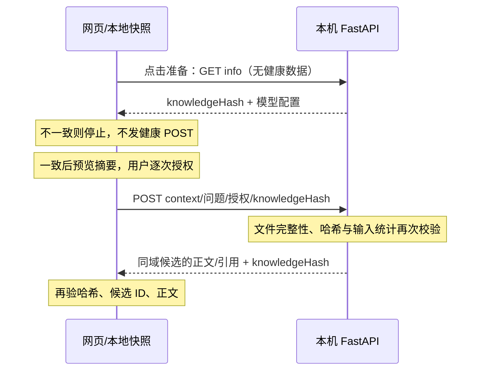

# 检索、版本一致性与后续 RAG

V0.7 使用标签/关键词，不生成 Embedding，不增加外部服务。保留离线本地教育预览；心理和中医领域彼此独立，不由一个领域推导另一个领域。

## 只有一份评分规则

`knowledge/retrieval.json` 保存：

```text
score = 标签命中数 + 2 × 关键词命中数
topK = { psychology: 2, tcm: 2 }
```

实际 score 以白名单表达式树保存，支持 tag_matches、keyword_matches、constant、add、multiply。发布器将相同表达式编译成 `src/generated/knowledge-ranking.ts` 和 `backend/generated_ranking.py`，不执行任意输入代码。

这是小型规则编译器：业务评分只写一份，两端保留各自数组循环与排序胶水。pnpm knowledge:check 检查生成文件逐字一致，跨语言测试再比较实际结果，避免“看起来相同、行为不同”。不增加后端 Node 运行时调用，也不需要新依赖。

每域分别过滤、评分、取 Top-K，再按 psychology/tcm 顺序组合。50 张心理卡也不会占用中医名额。某域没有正分候选时返回空，不用另一域代替。分数相同时按稳定 ASCII ID 升序，不依赖语言/操作系统的 localeCompare。

tags 是今日确实填写的四项指标名，使用 `!== null`；睡眠 0 仍是已填。keywords 对当前问题作区分大小写的字面子串匹配，不进行分词、同义词、语义或因果推断。没有今日记录直接返回空。每域 Top-K 允许 1–10 的整数，生产规则统一由 retrieval.json 配置，不让页面与后端各写默认值。

## 正式候选和稳定引用

正式快照只包含符合以下条件的卡：

1. 卡片和来源都 active，卡片 review 为 source_checked，professionalReview 不是 rejected。
2. 来源 verification 为 source_checked，卡片 sourceVersion 与当前来源 version 一致。
3. 原创转述必须在来源的 allowedUses 中；摘录必须明确 permitted 且允许 excerpt，未知授权不允许复制。
4. 来源存在、知识域一致、证据类型相符、ID 不重复，所有数据通过运行时结构校验。

来源核对与专业审核独立，当前未做专业审核的示例仍允许以明确标注的教育内容发布。检索器额外再过滤草稿/拒绝/归档，防止测试替身或未来调用误把这些卡送入候选。

外部模型仍只能选择本次候选的同域 ID 与固定反思句 ID；后端及前端分别核对引用和正文。PSY 的引用不能放到 TCM 中。卡片 ID 不随内容修改而变，版本会变；归档保留 ID，禁止物理删除已登记 ID 或复用。

## 三种版本信息

| 信息 | 作用 |
| --- | --- |
| source/card version | 每次受控修改、核对、专业审核或归档递增；卡记录它依据的来源版本 |
| manifest 每 ID 哈希 | 检测手改但未升版本、物理删除、规则变更未升版本 |
| knowledgeHash | 对整份正式快照的规范 JSON 作 SHA-256，包含卡片、来源、检索规则和生成实现指纹 |

JSON 规范化使用排序键、UTF-8 和固定分隔符；相同数据反复 build 得到相同哈希，不嵌入变化的构建时间。数组顺序规范化或保持约定，格式化源文件不会单独改变内容哈希。

前端把正式快照随应用构建打包，无网络也能预览。后端启动时验证源文件、manifest、快照和生成器结果，然后加载同一快照；每次配置/洞察请求还检查当前文件是否仍与进程一致。



API 保留 V0.6 路径和原字段，新增可选 knowledgeHash：旧请求仍可接受，新响应增加哈希字段；新版官方客户端准备调用必须获得相同哈希。409 表示版本/模型配置不一致，503 表示知识文件变化或校验失败；不调用外部模型。旧客户端不具备新版的发送前哈希门禁，须升级/刷新客户端，不能宣称任意旧客户端都有新保护。

静态网页无法在完全离线时得知知识已撤回。更新后需要重建/刷新前端并重启 API；当前页可能仍有旧本地预览，因此不是实时撤稿系统。已发出的模型请求也无法撤回。生产端公开发布仍未实现。

## 下一版怎样加 Embedding 与向量检索

现有稳定 ID、来源版本、授权与哈希是基础，下一步可按以下顺序小步实现，当前没有自动开发：

1. 先拿有明确允许用途的原创或授权材料，定义 Chunk 切分规则及原文定位；按 sourceId/sourceVersion/cardIds 绑定，保存每段 contentHash。
2. 固定 Embedding 模型/版本、维度和文本规范化方案。是否调用外部 Embedding 服务需另行授权；不能把健康记录或用户问题默认上传。
3. 首版可以用本地小规模向量文件和简单余弦相似度，数据量需要时再选索引工具，不先上数据库集群。
4. 按内容哈希重建或更新向量索引；修改/归档时旧 chunk/向量必须退出当前索引。用完整重建先确保正确，再考虑增量更新。
5. 先按域、生命周期、审核、授权过滤，再在各域检索 Top-K；向量分数只是相似度，不是医学证据强度。可结合关键词召回，再做去重与排序。
6. 用人工标注的虚构问题集评估正确引用、无答案拒答、领域覆盖、Recall@K 和撤回后的残留；通过后再接入生成，保留本次 JSON Schema/引用/授权门禁。

来源/正文存储、向量索引和模型回答是不同层；不能让 Embedding 绕开知识审核，也不能靠 RAG 自动保证回答正确。
